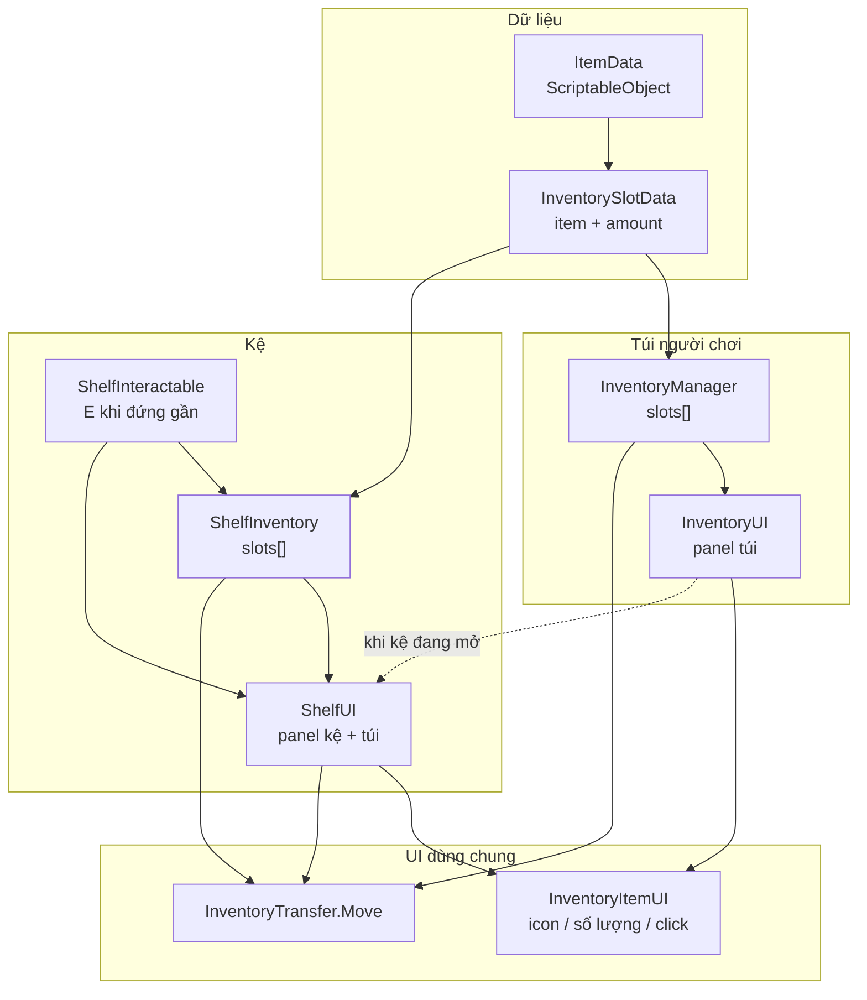
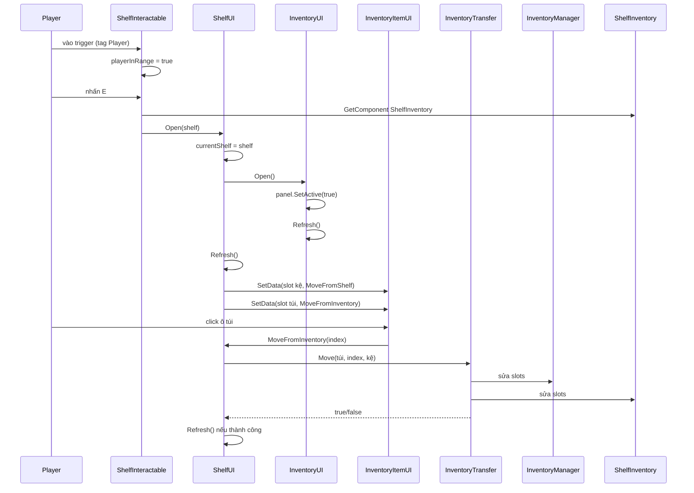
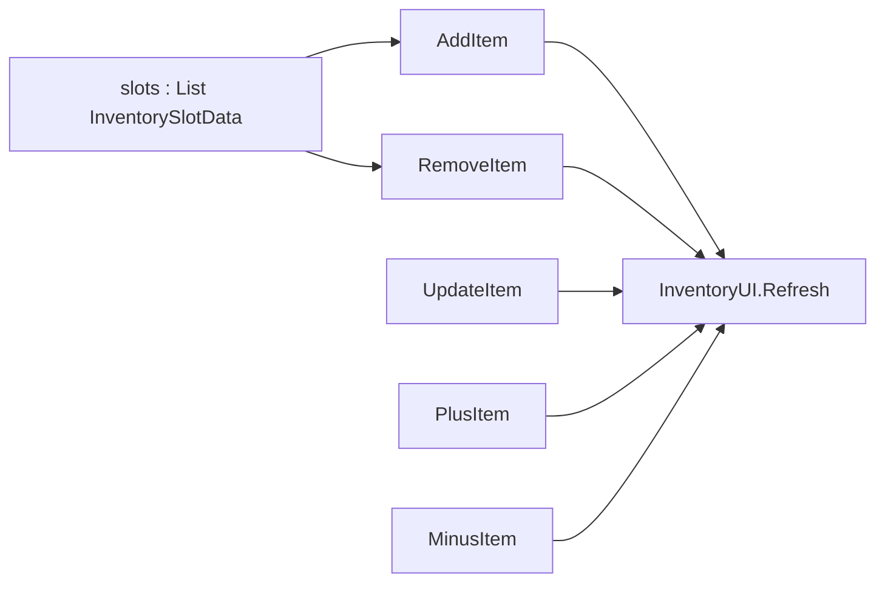
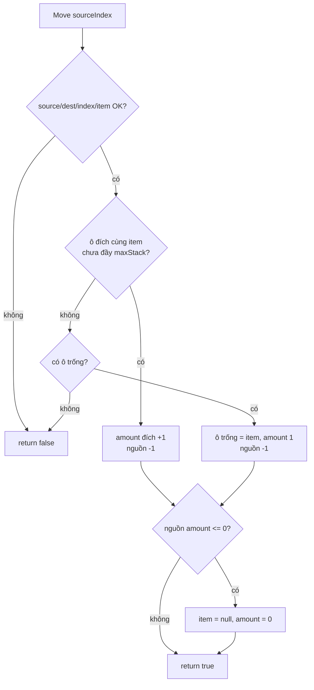
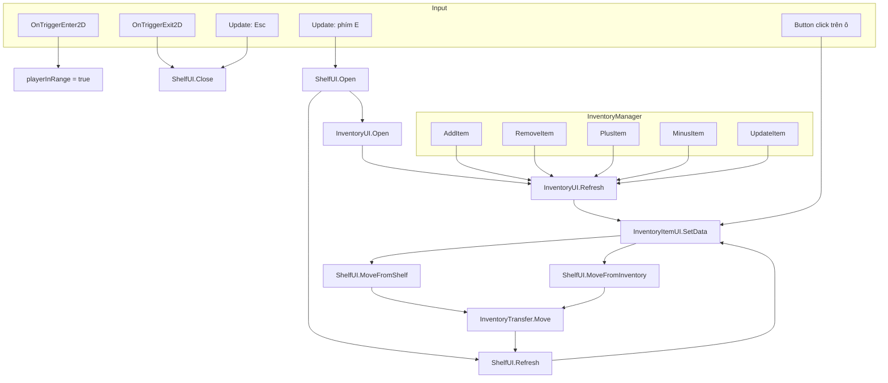

# TheDreams

Tài liệu này mô tả **chức năng từng hàm** và **mối liên kết** giữa các script trong:

- `TheDreams/Assets/Scripts/Inventory`
- `TheDreams/Assets/Scripts/Shelf`

Hệ thống hiện tại: **túi đồ người chơi** (`InventoryManager`) và **kệ trưng bày** (`ShelfInventory`) dùng chung kiểu ô chứa `InventorySlotData` + `ItemData`. Khi mở kệ, click item để chuyển **1 đơn vị** qua lại nhờ `InventoryTransfer`.

---

## 1. Tổng quan kiến trúc

**Luồng chơi chính**

1. Player đứng gần kệ → `ShelfInteractable` nhận trigger.
2. Bấm **E** → `ShelfUI.Open(shelf)`.
3. `ShelfUI` vẽ 2 lưới: ô kệ + ô túi, mỗi ô là `InventoryItemUI`.
4. Click ô kệ → `MoveFromShelf` → `InventoryTransfer.Move` (kệ → túi).
5. Click ô túi → `MoveFromInventory` → `InventoryTransfer.Move` (túi → kệ).
6. Bấm **Esc** hoặc rời collider → `ShelfUI.Close`.

---

## 2. Sơ đồ gọi hàm khi mở kệ và chuyển item

---

## 3. Folder Inventory

### 3.1. `ItemData.cs` — định nghĩa loại item

ScriptableObject (menu: **The Dreams / Inventory / Item**). Không có hàm; chỉ là dữ liệu tĩnh.

| Trường | Ý nghĩa |
|--------|---------|
| `itemId` | Mã item |
| `itemName` | Tên hiển thị |
| `icon` | Sprite trên UI |
| `maxStack` | Số lượng tối đa 1 ô (mặc định 99) |

**Liên kết:** được giữ trong `InventorySlotData.item`. `InventoryTransfer` và `InventoryManager.AddItem` đọc `maxStack` / `icon`.

---

### 3.2. `InventorySlotData.cs` — 1 ô chứa

Class `[Serializable]`, không có hàm.

| Trường | Ý nghĩa |
|--------|---------|
| `item` | Loại item (null = ô trống) |
| `amount` | Số lượng trong ô |

**Liên kết:** dùng chung cho `InventoryManager.slots` và `ShelfInventory.slots`. UI đọc để vẽ; transfer sửa trực tiếp 2 list này.

---

### 3.3. `InventoryManager.cs` — túi người chơi (singleton)

| Hàm | Vai trò | Gọi tới |
|-----|---------|---------|
| `Awake()` | Gán `Instance = this` | — |
| `AddItem(item, amount)` | Thêm item: chồng vào ô cùng loại chưa đầy stack, còn dư thì tạo ô mới | `InventoryUI.Refresh()` |
| `RemoveItem(item, amount)` | Trừ số lượng; nếu `amount <= 0` thì `slots.Remove(slot)` | `InventoryUI.Refresh()` |
| `UpdateItem(item, amount)` | Gán số lượng tuyệt đối; `<= 0` thì xóa ô | `InventoryUI.Refresh()` |
| `PlusItem(item, amount)` | Cộng thêm vào ô cùng loại (không check maxStack) | `InventoryUI.Refresh()` |
| `MinusItem(item, amount)` | Trừ; `<= 0` thì xóa ô | `InventoryUI.Refresh()` |

**Liên kết:**

- Nguồn dữ liệu cho `InventoryUI.Refresh` và nửa túi trong `ShelfUI.Refresh`.
- Destination/source của `InventoryTransfer.Move` khi chuyển với kệ.
- `AddItem` / `PlusItem` / … hiện **không** được kệ dùng; kệ chỉ sửa `slots` qua `InventoryTransfer`.

---

### 3.4. `InventoryItemUI.cs` — 1 ô trên UI

| Hàm | Vai trò |
|-----|---------|
| `SetData(data, onClick)` | Vẽ icon, hiện `xN` nếu `amount > 1`, gắn `Button.onClick` nếu ô có item và có callback |

**Liên kết:** prefab dùng bởi cả `InventoryUI` và `ShelfUI`. Callback thường là `ShelfUI.MoveFromShelf` / `MoveFromInventory`.

---

### 3.5. `InventoryUI.cs` — panel túi độc lập

| Hàm | Vai trò | Gọi tới |
|-----|---------|---------|
| `Start()` | Ẩn panel lúc bắt đầu | — |
| `Toggle()` | Bật/tắt panel; nếu vừa mở thì `Refresh()` | `Refresh()` |
| `Open()` | Bật panel và làm mới | `Refresh()` |
| `Refresh()` | Xóa con trong `itemGrid`, spawn 1 `InventoryItemUI` / ô túi | `InventoryItemUI.SetData`, có thể `ShelfUI.MoveFromInventory` |

**Hành vi click trong `Refresh`:**

- Nếu **kệ đang mở** (`ShelfUI.Instance.IsOpen`) → click ô túi gọi `ShelfUI.MoveFromInventory(index)` (chuyển lên kệ).
- Nếu kệ **đóng** → chỉ hiển thị, không gắn click chuyển.

**Liên kết:** `ShelfUI.Open` gọi `inventoryUI.Open()`. `InventoryManager` các hàm sửa số lượng cũng gọi `Refresh()`.

> Lưu ý: `Instance` được khai báo nhưng **chưa gán** trong `Awake` (khác `InventoryManager` / `ShelfUI`). Các chỗ gọi `InventoryUI.Instance` (trong `InventoryManager`) cần object này tồn tại trên scene.

---

### 3.6. `InventoryTransfer.cs` — logic chuyển 1 item giữa 2 list

Static class, không gắn GameObject.

| Hàm | Vai trò |
|-----|---------|
| `Move(source, sourceIndex, destination)` | Chuyển **đúng 1 đơn vị** từ ô `source[sourceIndex]` sang `destination`. Trả `true` nếu thành công |

**Thuật toán `Move`:**

1. Validate list / index / ô nguồn có item và `amount > 0`.
2. Ưu tiên **stack vào ô đích cùng `ItemData` chưa đầy `maxStack`**.
3. Nếu không có: tìm **ô trống** (`item == null`) rồi đặt item + `amount = 1`.
4. Trừ 1 ở nguồn; nếu nguồn hết thì `item = null`, `amount = 0` (ô vẫn còn trong list).
5. Không chỗ → `false`.

**Liên kết:** chỉ được gọi từ `ShelfUI.MoveFromShelf` và `ShelfUI.MoveFromInventory`.

---

## 4. Folder Shelf

### 4.1. `ShelfInventory.cs` — dữ liệu 1 kệ trong world

| Hàm | Vai trò |
|-----|---------|
| `Awake()` | Nếu `slots` đang rỗng, tạo `slotCount` ô trống (`item = null`, `amount = 0`) |

**Liên kết:** component trên object kệ. `ShelfInteractable` lấy component này khi mở UI. `ShelfUI` đọc/ghi `slots`.

---

### 4.2. `ShelfInteractable.cs` — đứng gần + nhấn E

| Hàm | Vai trò | Gọi tới |
|-----|---------|---------|
| `OnTriggerEnter2D` | Tag `Player` → `playerInRange = true` | — |
| `OnTriggerExit2D` | Rời player → `playerInRange = false` và **đóng kệ** | `ShelfUI.Close()` |
| `Update()` | Trong tầm, nhấn **E** → mở UI kệ | `ShelfUI.Open(GetComponent<ShelfInventory>())` |

Cần collider 2D (trigger) trên kệ và Player có tag `Player`.

---

### 4.3. `ShelfUI.cs` — UI kệ + túi khi tương tác

| Hàm / property | Vai trò | Gọi tới |
|----------------|---------|---------|
| `IsOpen` | `shelfPanel` đang bật hay không | dùng bởi `InventoryUI.Refresh` |
| `Awake()` | `Instance = this`, ẩn panel | — |
| `Update()` | Khi mở, **Esc** → đóng | `Close()` |
| `Open(shelf)` | Gán kệ hiện tại, bật panel, mở túi, vẽ lưới | `InventoryUI.Open()`, `Refresh()` |
| `Close()` | Ẩn panel, `currentShelf = null` | — |
| `SelectShelf(shelf)` | Đổi kệ đang xem (không đổi trạng thái mở) | `Refresh()` |
| `Refresh()` | Xóa 2 grid, spawn ô kệ + ô túi, gắn click chuyển | `ClearGrid`, `InventoryItemUI.SetData` |
| `MoveFromShelf(index)` | 1 item: kệ → túi | `InventoryTransfer.Move`, rồi `Refresh()` |
| `MoveFromInventory(index)` | 1 item: túi → kệ | `InventoryTransfer.Move`, rồi `Refresh()` |
| `ClearGrid(grid)` | Destroy toàn bộ con của grid | — |

**Hai lưới:**

| Grid | Nguồn data | Click |
|------|------------|--------|
| `shelfGrid` | `currentShelf.slots` | `MoveFromShelf` |
| `inventoryGrid` | `InventoryManager.Instance.slots` | `MoveFromInventory` |

---

## 5. Bản đồ “hàm nào gọi hàm nào”

---

## 6. Bảng trách nhiệm nhanh

| File | Loại | Trách nhiệm |
|------|------|-------------|
| `ItemData` | Data asset | Mẫu item |
| `InventorySlotData` | Data runtime | 1 ô (item + số lượng) |
| `InventoryManager` | Logic túi | List ô túi, thêm/sửa/xóa, singleton |
| `InventoryTransfer` | Logic thuần | Chuyển 1 đơn vị giữa 2 list |
| `InventoryItemUI` | View 1 ô | Icon, số lượng, click |
| `InventoryUI` | View túi | Mở/đóng/vẽ túi độc lập |
| `ShelfInventory` | Logic kệ | List ô kệ trên object world |
| `ShelfInteractable` | Input world | Tầm + phím E / đóng khi rời |
| `ShelfUI` | View kệ | 2 lưới, điều phối transfer |

---

## 7. Ghi chú khi đọc / mở rộng

- Transfer **không xóa phần tử list** khi ô hết item; chỉ null hóa. `InventoryManager.RemoveItem` / `MinusItem` thì **Remove** phần tử — hai kiểu khác nhau.
- Mỗi lần `Refresh` **Destroy + Instantiate** lại toàn bộ ô (chưa dùng object pool).
- `InventoryUI.Instance` chưa được set trong `Awake`; nếu `InventoryManager` gọi `Refresh` khi scene chưa gán Instance sẽ lỗi null.
- `AddItem` luôn log `"Inventory đã đầy!"` kể cả khi vẫn thêm được (log nằm sau vòng tạo slot, không có check capacity thật).
- Click chuyển item từ panel túi độc lập **chỉ hoạt động khi kệ đang mở** (`IsOpen`).
